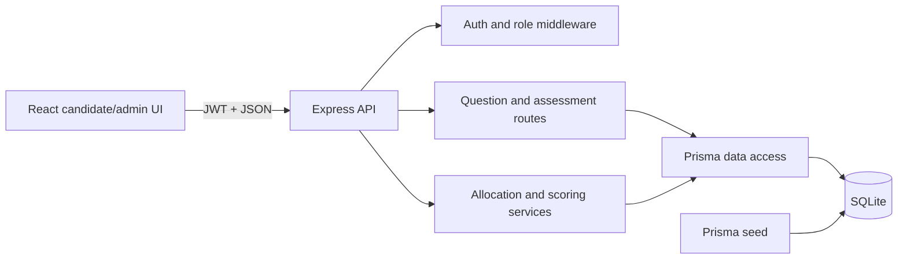
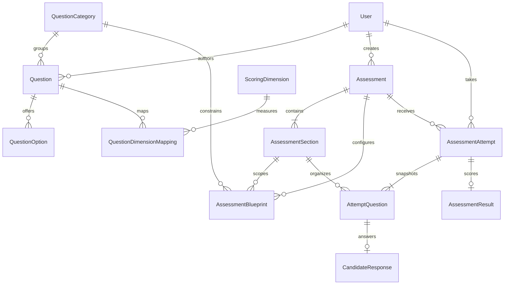

# Architecture and data model

## High-level design

The frontend owns presentation and transient form state. Express routes validate inputs and enforce role/ownership checks. Allocation and scoring are isolated pure services. Prisma persists question bank and assessment configuration, saved responses, attempt snapshots, and one result per attempt.

## Entity relationship diagram

The canonical columns, foreign keys, unique constraints, and indexes are defined in [`backend/prisma/schema.prisma`](../backend/prisma/schema.prisma).

## Model and constraints

- `User` contains the local account identity and role. `AssessmentAttempt` has a unique `(assessmentId, candidateId)` key for one idempotent attempt per candidate and assessment.
- `Question` stores reusable item metadata; `QuestionOption` stores answer choices and server-only correctness or situational score values.
- `AssessmentSection` and `AssessmentBlueprint` describe section quotas. A blueprint row is unique by `(sectionId, categoryId, difficulty)`.
- `AttemptQuestion` stores immutable candidate-visible text, safe option ordering, marks, and private server-side score metadata. It is unique by `(attemptId, questionId)` and display order.
- `CandidateResponse` is upserted by the unique `attemptQuestionId`. `AssessmentResult` is upserted by the unique `attemptId`.
- `QuestionDimensionMapping` models a many-to-many relation with weight and reverse-scoring metadata.

### Normalization and snapshots

Categories, options, sections, dimensions, mappings, attempts, answers, and results are separate relational entities to avoid duplicating mutable authoring data. The JSON snapshot columns are intentional denormalizations at the attempt boundary: they preserve exactly what was served and the private scoring inputs needed after question edit or archive. Result JSON stores computed section and dimension summaries; it is written once and not used as source configuration.

## Index rationale

| Index/constraint | Access pattern |
|---|---|
| `Question(categoryId, difficulty, status)` | Eligible pool counts and allocation |
| `Question(type, status)` | Active type filtering |
| `Assessment(status, type)` | Candidate published assessment list |
| `AssessmentAttempt(candidateId, status)` | Candidate's active/completed attempts |
| `AssessmentAttempt(assessmentId, status)` | Reviewer/admin assessment activity |
| `AttemptQuestion(attemptId, sectionId)` | Load ordered attempt sections |
| `QuestionOption(questionId, position)` | Stable option retrieval |
| Unique composite constraints | Prevent duplicate attempt, question, option order, response, result, and blueprint row |

SQLite is sufficient for a local single-instance assignment. A production multi-instance deployment should use PostgreSQL, secure secret management, stronger account lifecycle controls, rate limiting, audit events, and transactional concurrency tests against the selected database.
